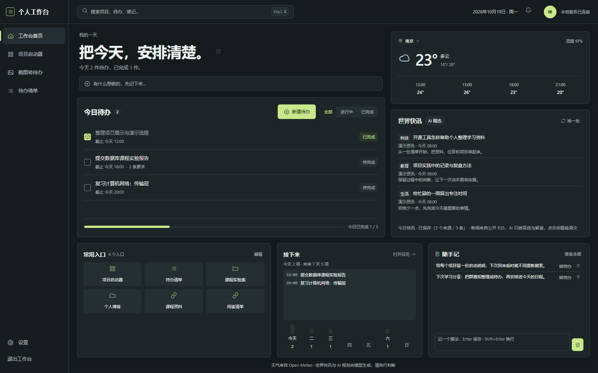

# 个人工作台

> 它不是某个问题的解决方案，而是一系列功能的聚合体——每个人的工作台，都不尽相同。

我们想搭建一个个人工作台，用来解决日常学习和工作中的一些问题：你缺什么，就往里加什么。

最开始，我们只是想把散落的项目放到一起，方便随时打开。现在，工作台也能接住群里的通知、今天的待办、长期的学习计划，还有临时冒出来的一个想法。

**集中项目、整理通知、安排待办、记录想法，都放在一个本机工作台里。**

## 现在的痛点

学习中，你做完了一个又一个项目。可这些项目，事后你还在持续使用吗？有没有常回头看看？

我现在的项目就散落在各个文件夹里，平时接触不到，存在感自然低——只能吃灰。偶尔想回头看看，还得翻文件夹、回忆怎么跑，于是更不想动了。

事情也差不多。老师在群里发了通知，截了图，却忘了把截止时间记下来；想复习一门课，计划写了不少，今天具体做什么还是没安排；突然有个想法，随手记在某个地方，之后又找不到了。

所以，我们继续往这个工作台里加功能：项目能打开，通知能变成待办，计划能落到每天，想法也有地方放。

## 界面预览



*当前产品首页。图中的任务、项目、笔记、天气和新闻均为演示数据，用于展示界面。*

## 第一个功能：项目集中 + 启动器

工作台的第一个功能，就是冲着这个痛点来的：把散落的项目集中到一处，让你闲来无事时，能随手回顾任何一个项目。

- 自动扫描你指定的目录，把发现的项目汇成一张清单
- 为项目配置一个或多个“启动配方”：跑命令、开 IDE、开文件夹或打开网页
- 根据 Python、Node、静态网页、Go、Rust、Django 等项目特征建议配方；识别不准时可以手动调整，运行前核对命令
- 支持改名、搜索筛选、移除和恢复；受管理命令使用独立控制台，也能从工作台停止进程树

项目管理操作不会删除磁盘上的项目文件。打开 IDE、文件夹和网页属于外部打开动作，不作为命令进程管理。各类项目的实际核验情况见[验收记录](docs/acceptance.md)。

## 第二个功能：截图转待办

群通知里往往同时有时间、要求和提交方式。每次都靠自己重新抄一遍，容易漏；只留一张截图，又不方便安排和提醒。

现在可以把截图或文字交给工作台，让 AI 先整理出待办草稿，再由你核对后保存。

**截图 / 文字 → AI 提取 → 核对编辑 → 保存待办 → 回看原文原图。**

- 核对截止时间、任务要求和原文依据，修改或删掉不合适的草稿
- 保存后进入同一份待办清单，之后也能回看任务来自哪段文字、哪张图片
- 没有截图也能直接手动新建，不必每件事都经过 AI

导入、核对和后续管理都在工作台里完成。AI 草稿需要人工核对，尤其是相对日期、适用对象和不明确的要求。

## 第三个功能：把待办安排到每天

任务记下来了，还得知道今天做什么、做到了哪一步。我们给待办加了月历、筛选和长期任务，让零散的事情能排进日程。

- 用月历按天查看任务，在列表里搜索、筛选、编辑和标记完成
- 把长期目标拆成计划，或按周期生成习惯任务，查看完成进度
- 不知道怎么拆时，让 AI 给出规划草稿，预览后再决定是否保存
- 为任务设置“提前 N 分钟”或“指定时间”提醒
- 在列表或详情里删除任务，删除前弹窗确认；取消、Esc 和点击遮罩都不会删除

任务删除后不可撤销，来源记录会保留。提醒的运行条件见下方[使用边界](#使用边界)。

## 每天从首页开始

不想一进来就翻好几个页面，首页先把常用的东西放在眼前：

- **我的一天**：快速存待办或笔记；首页大字可以编辑，“我的空间”里可以修改显示名和签名
- **今日待办**：查看今天到期和逾期未完成的任务，直接勾选完成；未安排日期的任务另有入口处理
- **天气与世界快讯**：记住你选的城市，查看天气和来自公开 RSS 的新闻，点击标题阅读原文
- **常用入口与接下来**：打开模块、最近使用的项目和自定义链接，查看今天与未来一周的安排
- **随手记**：多行记录想法，Enter 保存、Shift+Enter 换行；单条最多 1000 字，支持查看全文、编辑、复制、转待办和删除

想找之前的内容，按 **Ctrl + K** 搜索项目、待办、长期任务和笔记，点击结果进入对应内容。

整站使用深墨绿、炭灰和浅黄绿的界面，支持浏览器窗口自适应。窗口缩小时卡片会重新排列，调整窗口时会保留尚未保存的输入。

## 安装与首次使用

需要 **Windows + Python 3.12 或更高版本**，安装 Python 时包含 Python Launcher。首次安装依赖需要联网，日常界面不依赖 CDN 或 Node 构建工具。

1. **获取代码**：日常试用建议打开[稳定版 v0.5.3 源码](https://github.com/Echo2580/personal-workbench/tree/v0.5.3)，选择 **Code → Download ZIP**，解压到自己选的目录。
2. **安装依赖**：在解压后的仓库根目录双击 `install.cmd`。脚本会在当前仓库内创建专用 `.venv`，按锁文件安装依赖。
3. **打开工作台**：安装完成后双击 `start.cmd`，服务就绪后会自动打开首页。以后日常使用都从这里进入。
4. **接入项目**：进入“设置 → 扫描目录”，添加你存放项目的目录。只想用待办和笔记，也可以先跳过这一步。

习惯使用 Git 的话，可以这样获取同一稳定版，再双击 `install.cmd`：

```powershell
git clone --branch v0.5.3 --single-branch https://github.com/Echo2580/personal-workbench.git
```

**普通用户只需要一个仓库目录。** 下方的稳定版 / 开发版双目录安排是本项目的开发方式，不是安装前提。

## 可选：配置 AI 功能

截图 / 文字提取、AI 规划和世界快讯的 AI 筛选使用 DeepSeek，需要你自己的 API Key，当前默认模型为 `deepseek-flash`。

在 Windows 搜索“编辑账户的环境变量”，新建用户变量 `DEEPSEEK_API_KEY`，值填入自己的密钥。保存后重新启动工作台；如果没有生效，注销并重新登录 Windows 后再打开。

项目管理、手动待办、随手记和数据备份不需要模型密钥。新闻的 AI 筛选失败时会退回标题列表，仍可打开原文。

使用 AI 提取时，提交的截图或文字会发送到模型服务；AI 规划会发送相应目标与规划输入；世界快讯会发送候选新闻内容供模型筛选。调用按模型服务的账户规则计费，使用前自行确认输入内容。密钥放在本机环境变量里，不要写进仓库或备份文件。

## 数据与备份

个人配置和运行数据默认保存在**当前项目目录内的 `data\`**，已被 Git 忽略。服务只绑定本机 `127.0.0.1`，从 17843–17852 中选取可用端口；实际地址以启动后打开的页面为准。

在“设置 → 数据备份与恢复”可以导出和导入备份。恢复前会自动保存一份当前数据。

| 备份包含 | 备份不包含 |
|---|---|
| 待办、长期任务、随手记、首页偏好、项目配置等 | 项目代码、任务来源原图、运行日志、AI 密钥 |

备份会保存任务的来源记录，但不会打包截图原文件；需要保留的原图请另外留存。需要临时指定数据目录时，可使用启动器的 `--data-dir` 参数或 `WORKBENCH_DATA_DIR` 环境变量。

## 使用边界

- **提醒需要页面保持打开**：服务和工作台页面运行期间才会提示；打开页面前已经到点的提醒不会补发，不能替代系统级提醒。
- **联网功能依赖外部服务**：天气使用 Open-Meteo，新闻读取公开 RSS，AI 使用所配置的模型服务。离线时仍可使用本地项目管理、手动待办和笔记。
- **目前面向 Windows 本机使用**：浏览器窗口自适应不等于手机访问已配置；默认没有公网访问或多设备同步。
- **项目识别仍有边界**：自动配方是建议，特殊目录结构、缺少工具链或依赖的项目需要手动配置。

## 稳定版与开发版

截至 2026-10-24，当前稳定版为 **[v0.5.3](docs/releases/v0.5.3.md)**。GitHub 的 `main` 用于持续开发，可能包含尚未发布的改动；日常试用优先选择已发布的 tag。

我们本地采用两个目录，分别保留代码、Python 环境和数据：

| 目录 | 用途 | 启动入口 | 默认数据目录 |
|---|---|---|---|
| `wb`，主仓库 `main` | 开发与验证 | `start-dev.cmd` | `wb\data` |
| `wb-stable`，独立 worktree | 日常稳定使用 | `start.cmd` | `wb-stable\data` |

**`start-dev.cmd` 不会创建副本，也不会自动换一个数据目录。** 它启动所在仓库的代码，默认仍使用该仓库的 `data\`。两个目录的隔离来自两个实际副本，设置相同的 `WORKBENCH_DATA_DIR` 则会覆盖这个默认安排。

开发提交不会自动更新稳定工作树。每次迁移后，用 annotated tag 标记实际部署的提交；发布与回滚操作见[发布流程](docs/release.md)。

## 最近更新与验证

- **v0.5.3**：改进项目边界与名称识别，修正 Node/Go 入口误判，增加内部目录提示、启动检查及失败详情；保留人工名称和配方。
- **v0.5.2**：待办列表与详情统一使用删除确认弹窗，补充取消、失败重试和焦点恢复。
- **v0.5.1**：随手记查看全文、编辑与多行输入，修复天气同名城市匹配。
- **v0.5.0**：扩展项目识别，增加首页大字编辑与“我的空间”，支持自定义提醒，数据根迁入项目目录。

**v0.5.3 发布前的完整自动回归记录为 1036 项通过、4 项跳过**；这是该版本的历史验证结果。范围与限制见[v0.5.3 发布记录](docs/releases/v0.5.3.md)，更完整的使用场景见[验收记录](docs/acceptance.md)。

## 常见问题

**升级后，页面看起来还是旧版？**

浏览器可能保留了旧的 JS / CSS。在工作台页面按 **Ctrl + Shift + R** 或 **Ctrl + F5** 强制刷新，再检查新功能。发布标签与[发布记录](docs/release.md)用于确认代码版本。

**双击后没有打开页面？**

先在仓库目录双击 `start.cmd`，保留弹出的错误信息，确认已运行 `install.cmd`。运行期日志在 `data\logs\service.log`。升级后若提示缺少依赖，重新运行 `install.cmd`；反馈问题时请附上版本、启动方式和错误信息，并去掉密钥及个人内容。

**移除项目或换一个代码目录，会影响数据吗？**

从项目清单移除只会隐藏条目，不会删除项目文件。工作台数据默认跟着代码目录走；迁移目录或重新下载前，先从设置页导出备份，并另外保存需要保留的原始资料。

## 后续计划

- 提高项目自动识别的覆盖面和配方正确率
- 结合连续使用记录，继续打磨首页、待办和常用入口
- 验证不同 Windows 电脑上的安装与升级流程

这个工作台是没有边界的——你有任何需求，都可以加进来。

想法和功能，我们会通过 Issue 一起讨论。欢迎把你的需求带进来，把它变成“你的”工作台。
